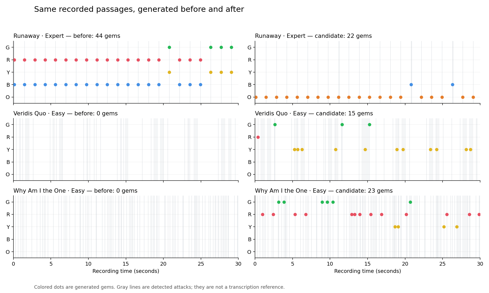

# Chart generation: seven-song investigation

The baseline is `f883f7e`, before the generator changes. The seven user-supplied MP3s were decoded in
full at 22,050 Hz, using the louder stereo channel to match Studio. Songs and lyrics remain outside
the repository. This report records mechanical and signal-analysis findings; human playtesting is
still needed to judge whether an arrangement is enjoyable.

## Findings that explain the reported feel

**Quiet phrases disappeared on easier difficulties.** The baseline ranked attacks across the whole
recording, so a loud chorus consumed the difficulty's quota. The first 30 seconds of both
**Why Am I the One** and **Veridis Quo** contained detected attacks but no Easy notes. Veridis Quo
also had no Medium notes in that passage. Difficulty reduction now works within eight-beat passages,
and attack levels are normalized over nearby audio. Quieter musical material can retain a rhythm.

**Single notes became chords because they were loud.** Runaway's first 30 seconds had 22 attack
positions and 44 Expert gems: every attack became a two-button chord. The opening spectrum has a
clear repeated pitched component near 1.32 kHz, with later lower notes; the old chord rule used only
attack strength. The candidate retains those 22 attack positions as single notes. Chords and sustains
remain available for manual authoring; automatic loudness-based chords were removed.

**Timbre changes moved the frets.** The old algorithm walked one lane up/down whenever spectral
brightness changed. Percussion, vocals, changing filters and harmonic balance could move the hand
without a corresponding melodic change. The candidate estimates pitched attacks from before/after
4,096-sample spectra, suppresses broad spectral backgrounds, scores harmonic support, and checks
spectral flatness. A fixed pitch-derived mapping supplies frets across difficulties. Short unpitched
accents keep the melodic position; longer unpitched passages use consistent low/mid/high roles.
These estimates can still follow a vocal or another prominent instrument in a full mix.

**The tempo search could settle on an unrelated pulse.** Refinement searched only near the original
autocorrelation maximum, with a substantial preference around 120 BPM. The candidate searches the
whole supported range using correlation and event-phase coherence. For example, Runaway's opening
attacks are about 1.38 seconds apart: the candidate's approximately 174 BPM grid fits four beats into
that interval, while the old 121.47 BPM grid does not fit a simple subdivision. Half/double-time and
compound-meter interpretations remain ambiguous.

**Some music needs multiple tempo points.** In Why Am I the One, 24-second local onset windows
support an approximately 166 BPM pulse early and approximately 148 BPM later. A single global BPM is
insufficient. Consecutive windows with strongly different, non-equivalent pulses now flag the Grid
inspector and reduce the automatic grid's influence on selection. The author can add tempo points;
detected note times retain their positions in recording seconds.



## Measured results

The counts below use the default **Melody + rhythm** focus. They show the intended simplification of
uncertain material as well as restored quiet passages. Expert is the densest of the generated drafts;
it is not a human-authored difficulty rating.

| Recording | Seconds | Easy attacks in first 30 s, before → candidate | Expert attacks, before → candidate | Old automatically added Expert gems |
| --- | ---: | ---: | ---: | ---: |
| Good Morning | 195.09 | 36 → 29 | 847 → 467 | 31 |
| Stronger | 311.87 | 23 → 18 | 1,083 → 474 | 140 |
| Harder, Better, Faster, Stronger | 226.41 | 11 → 19 | 1,030 → 368 | 12 |
| Why Am I the One | 286.71 | 0 → 23 | 865 → 447 | 99 |
| All Alright | 237.47 | 19 → 14 | 570 → 290 | 137 |
| Runaway (feat. Pusha T) | 547.73 | 22 → 11 | 2,027 → 999 | 108 |
| Veridis Quo | 345.19 | 0 → 15 | 2,168 → 1,797 | 4 |

The candidate adds zero automatic chord gems. Its estimated global grids are respectively 169.95,
103.97, 123.49, 148.06, 80.49, 173.99 and 106.92 BPM. The Why Am I the One estimate is explicitly flagged
as variable; the first and sixth can be interpreted at approximately half their reported tempo.
These estimates are diagnostics, with no independently annotated beat-reference dataset.

Analysis and initial four-difficulty generation took approximately 1.1–2.9 seconds per full recording
on this workspace's CPU, excluding decode. Browser/device performance will differ.

All **84 charts** (seven songs × three focuses × four difficulties) passed lane bounds, minimum gaps,
rolling burst limits, nested difficulty attacks, chart timing round trips under 3 ms, and bot full
combos. All seven actual MP3s also passed native browser import, focus regeneration with protected
passages, feature persistence/ZIP restoration, bot preview/return, and 320/390 px layout checks.

Controlled musical fixtures supply the timing/pitch ground truth: a repeated pitched riff changes
gain by 15× and varies its second harmonic while independent noise hits fill the gaps. Melody mode
retains at least 90% of its musical attacks, estimates at least 90% of the fundamentals within half a
semitone, keeps the same frets for repeated pitches and rejects at least 80% of the separate noise hits.
Additional fixtures check quiet-passage coverage, varying tempo, locks/undo, safe storage and progress.

The production single-file build also passed MP3/WAV/Opus/M4A imports, saving and recovery from a
simulated storage failure. A full-song production import checked the variable-tempo warning,
generation focus undo/redo and bot return. The broader editor audit passed on Runaway, including
manual edits, tempo changes, saved reload, playtesting and cancellation; worker-blocked fallback and
bot completion passed on a separate recording. The full unit suite, production build and frame
benchmark passed.

## How to use the change

New imports use **Melody + rhythm**. In **Passage**, choose **Generation follows** and regenerate an
unlocked passage in the selected difficulty:

- **Melody + rhythm** balances clear pitched attacks with stronger rhythmic accents.
- **Melody & riffs** follows clear pitched attacks. It can be sparse in dense or highly processed
  mixes; Studio displays a coverage hint in that case.
- **Rhythm accents** follows the attack pattern with stable low/mid/high frequency-band roles.
  This offers a useful alternative for beat-driven recordings with little identifiable guitar.

There is no automatic instrument identity, polyphonic guitar transcription, vocal removal or tempo-map
transcription. Octave errors, source switching and missed/extra attacks remain possible in dense mixes.
The changes improve the basis of an editable draft. Separated instrument audio or a trained model
could improve source specificity later. Existing saved charts keep their authored notes; reimport the
recording for the new analysis features. Regeneration preserves locked notes and other difficulties.

## Reproduce

The optional audit tools need Node 24 and FFmpeg; browser checks additionally need Playwright/Chromium.
Keep the recordings in a local directory. No songs are fetched, uploaded or added to Git.

```sh
# Optional baseline capture, using source from before this change:
git worktree add /tmp/reclone-quality-baseline f883f7e
MUSIC_DIR=/path/to/music SOURCE_ROOT=/tmp/reclone-quality-baseline CAPTURE_BASELINE=1 \
  AUDIT_OUTPUT=/tmp/chart-quality-baseline node tests/tools/studio-quality-audit.mjs

# Candidate analysis and all focus/difficulty combinations:
MUSIC_DIR=/path/to/music BASELINE_DIR=/tmp/chart-quality-baseline \
  AUDIT_OUTPUT=/tmp/chart-quality-candidate node tests/tools/studio-quality-audit.mjs

# Start Vite on port 5230 first; these imports use the real browser decoder and worker.
PLAYWRIGHT_MODULE=/path/to/playwright/index.mjs CHROME_PATH=/path/to/chromium \
  MUSIC_DIR=/path/to/music node tests/tools/studio-quality-browser.mjs
```

The output directory contains per-song analysis/project JSON, chart text for all three focuses and a
summary with source-file SHA-256 fingerprints. It contains no audio copies. For an A/B review, capture
the baseline first and compare the same passages after a new Studio import. Musical choices should be
checked with **Hear chart notes**, **Watch bot** and a human playtest.
